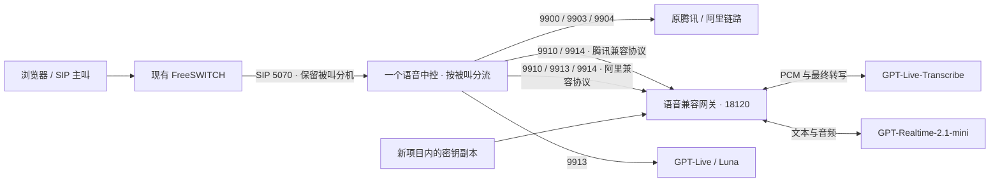
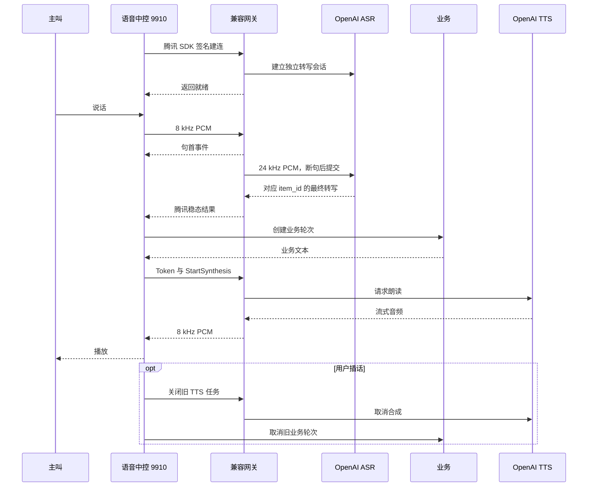

# OpenAI 语音兼容网关

本机服务在 `127.0.0.1:18120` 兼容项目所用的腾讯 `8k_zh`、阿里 `CreateToken` 和普通语音合成。MjSIP 的现有 Java SDK 照常收发协议。真实转写使用 `gpt-live-transcribe`，合成使用 `gpt-realtime-2.1-mini`。

## 拨测入口

[打开现有 8080 拨测页](http://127.0.0.1:8080/mjsip-call-test/)。

| 分机 | 对照分机 | 经过 18120 的功能 |
|---|---|---|
| [9910 · 复述](http://127.0.0.1:8080/mjsip-call-test/?route=9910) | 9900 | 识别和合成 |
| [9913 · 委派播报](http://127.0.0.1:8080/mjsip-call-test/?case=openai-client-single) | 9903 | 合成 |
| [9914 · 查订单](http://127.0.0.1:8080/mjsip-call-test/?route=9914) | 9904 | 识别和合成 |

FreeSWITCH 将所有分机桥接到同一个语音中控 SIP/UDP 5070。语音中控按 SIP Request-URI 分流，三个对照分机选择语音网关的 18120 兼容端点。

## 启停

1. 运行 `./scripts/build.sh -o package`。脚本使用同一工作区已有 Java 17、Maven 和依赖缓存。可用 `MAVEN_REPO_LOCAL` 指定其他缓存。
2. 首次配置把 MjSIP 项目的 `.local/openai-live.env` 完整复制到本项目的 `.local/openai-live.env`，副本权限设为 `0600`。新服务读取副本中的 `OPENAI_API_KEY` 与 `OPENAI_LIVE_HTTP_PROXY`。轮换密钥时分别更新副本和原文件，并重启对应服务。
3. 运行 `./scripts/start.sh` 启动语音网关。首次启动会生成本项目的 `.local/compat.env`，供语音中控和语音网关完成协议鉴权。字段见 [配置模板](config/compat.env.example)。
4. 在 [拨测项目](../mjsip-call-test/) 运行 `./start.command` 启动语音中控和拨测服务。首次部署探针代理时使用拨测项目的 `install-navigation.py`。浏览器继续使用 8080 入口。
5. 在各自终端按 Ctrl+C 可分别停止拨测服务和语音网关。

## 架构与数据流

## 验收入口

[查看本轮验收结果与录音](ACCEPTANCE.md)。

- `tests/media.py --ephemeral` 用实际 SDK 和 SIP/RTP 直连测试本机 OpenAI 夹具。
- `tests/media.py --ephemeral --through-switch` 另起隔离 FreeSWITCH，跑同一组桥接用例。
- 两种电话测试均可加 `--long-tts`，验证 9910 和 9913 收到持续合成约 12.5 秒的任务尾音。可用 `--media-jar` 指定语音中控制品。
- `tests/tts_timeouts.py --compat-jar JAR --output-dir DIR` 核对长任务的完整 PCM、阶段超时、慢读、断开和复用旧事件。
- `tests/concurrency.py` 只连本地夹具，验证 ASR／TTS 独立准入、慢读和超时回收、TTS 连接复用及旧任务隔离。两个脚本都支持 `--compat-jar` 和 `--output-dir`。
- `tests/live_calls.py .local/measure --routes 9900 9910 --sample order-2 --barge --rounds 30 --parallel 6` 走现有 FreeSWITCH 测云端线路，生成逐轮 JSON 和双声道 WAV，左声道为上行、右声道为返听。自动插话指标按录音间隙识别候选边界，需结合录音核对旧音与新音。实际云端拨测按账号用量计费。
- `/healthz` 返回 ASR／TTS 各自的活动会话、限额、空闲 TTS 上游数及分类计数。日志记录上游建连、会话就绪、提交到最终转写、发起生成到首块 PCM 和网关首块 PCM 发出等阶段。

## 并发和超时

环境变量 `COMPAT_ASR_LIMIT` 与 `COMPAT_TTS_LIMIT` 默认各为 64。名额按兼容协议独立计数，从 WebSocket 建立起占用，连接及上游任务清理后释放。超限沿用 WebSocket `1013 Busy`。

网关按会话顺序异步发送兼容协议的结果和 PCM，慢读下游触发写入超时并回收该会话。ASR 最终转写等待期限由 `COMPAT_ASR_RESULT_TIMEOUT_MS` 配置，默认 12000 毫秒，从该句提交时开始计时。通话中的静音和断句继续沿用原协议。

TTS 客户端在 WebSocket 建立后有 3 秒提交 `StartSynthesis`。有效请求按以下期限执行，单位为毫秒。

| 环境变量 | 默认值 | 适用阶段 |
| --- | --- | --- |
| `COMPAT_TTS_READY_TIMEOUT_MS` | 5000 | 等待上游冷连接就绪 |
| `COMPAT_TTS_FIRST_AUDIO_TIMEOUT_MS` | 6000 | 提交合成后等待首块 PCM |
| `COMPAT_TTS_AUDIO_IDLE_TIMEOUT_MS` | 5000 | 下游上一块写完后，等待下一块有效 PCM 或完成事件 |
| `COMPAT_TTS_TOTAL_TIMEOUT_MS` | 30000 | 从 `StartSynthesis` 起的合成总时限 |

下游写入期间仍执行独立的发送限制和合成总时限。超时返回原有的 `TaskFailed`，阶段原因可在 `/healthz` 的 `tts_ready_timeout`、`tts_first_audio_timeout`、`tts_audio_idle_timeout`、`tts_total_timeout` 计数中查看。调整总时限时，启动 18120 和拨测服务使用相同的 `COMPAT_TTS_TOTAL_TIMEOUT_MS`，使 9913 的单句等待能覆盖上游期限和终止事件。

TTS 只保留正常结束、能够校验响应归属的上游连接。每条连接一次服务一个任务，空闲 30 秒回收，取消或失败后关闭。默认最多保留 4 条，可通过 `COMPAT_TTS_IDLE_LIMIT` 调整，设为 0 时每个任务新建上游连接。连接复用不会提前发起合成请求。
